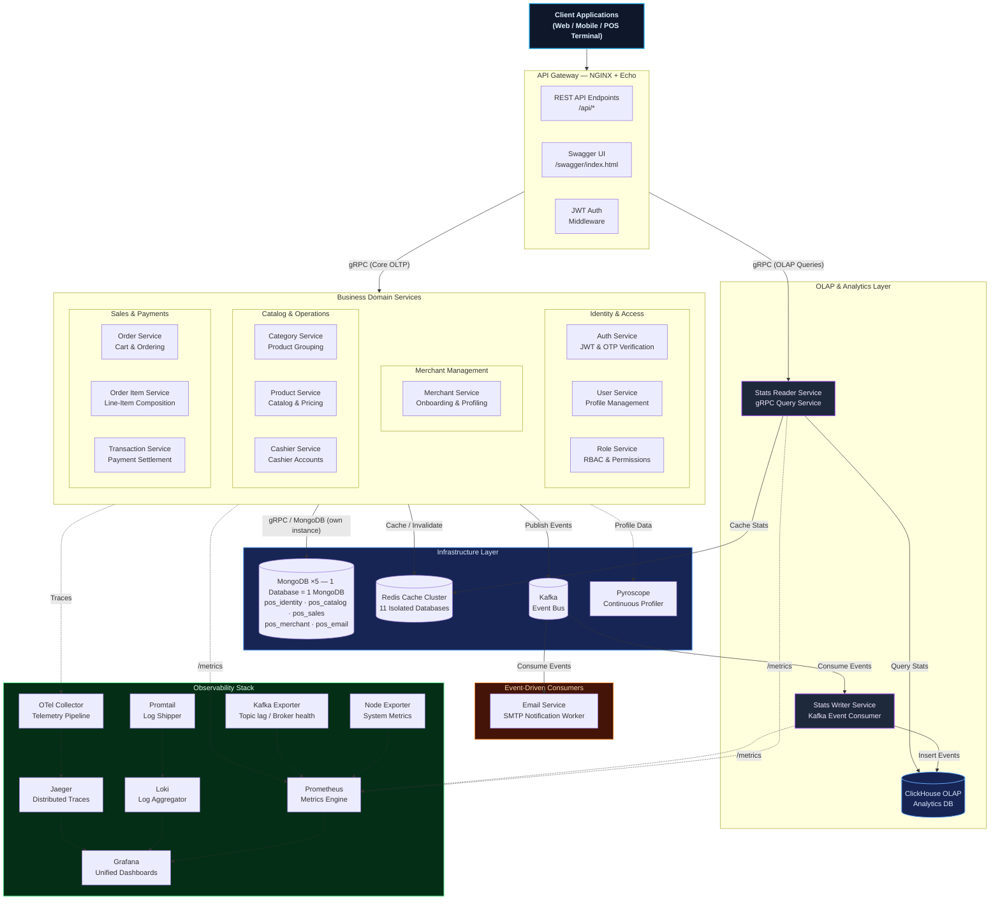
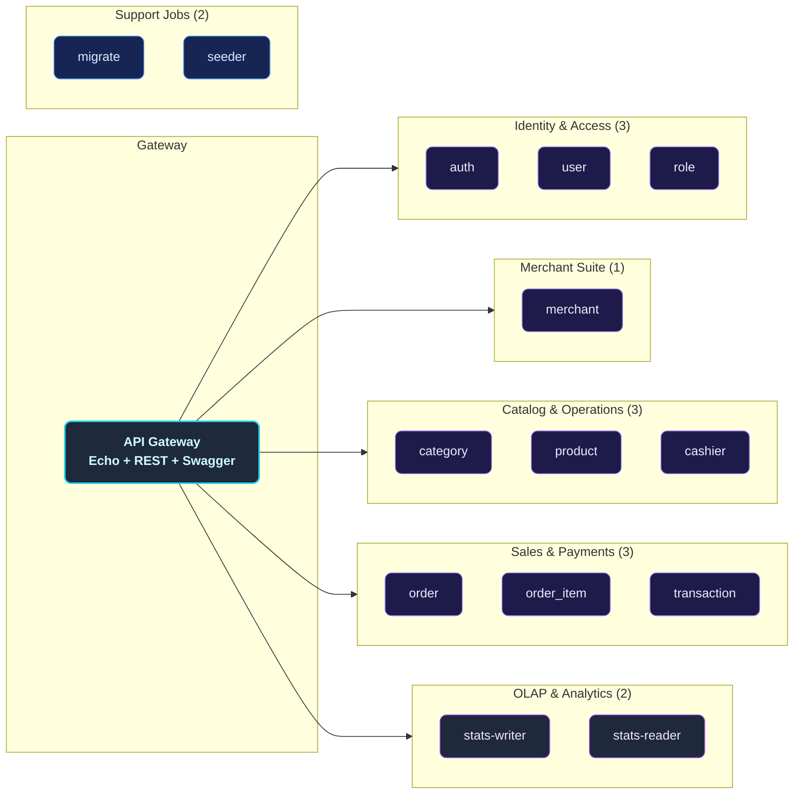
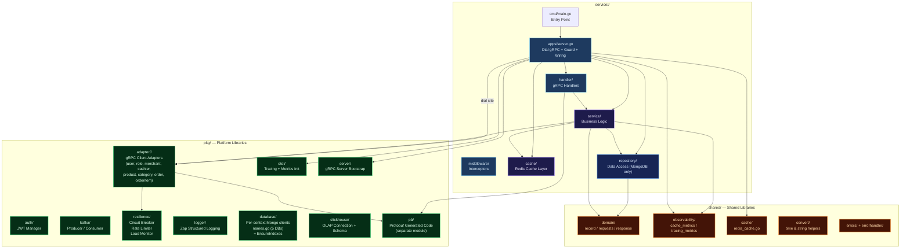
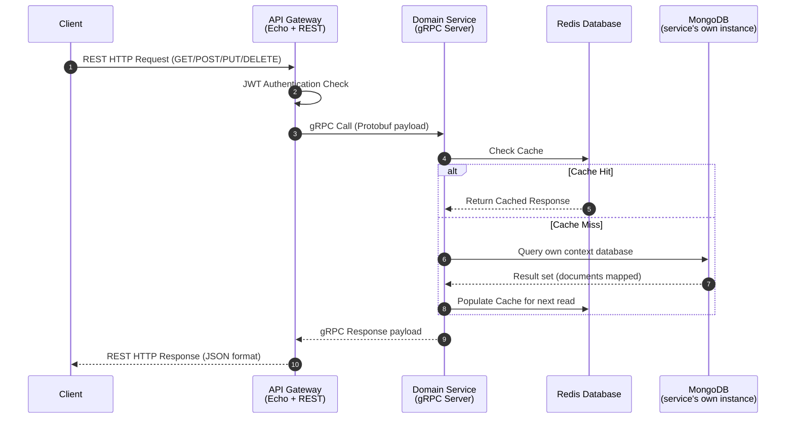
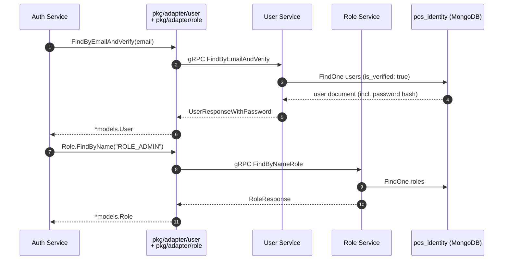
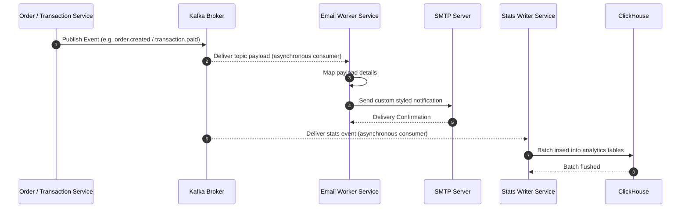
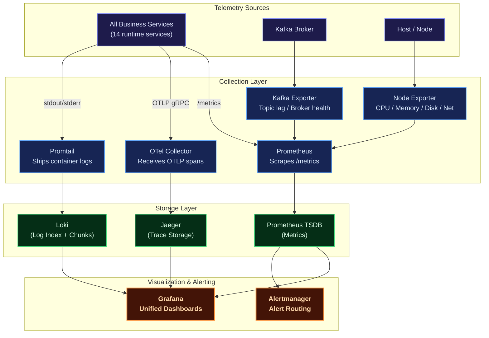
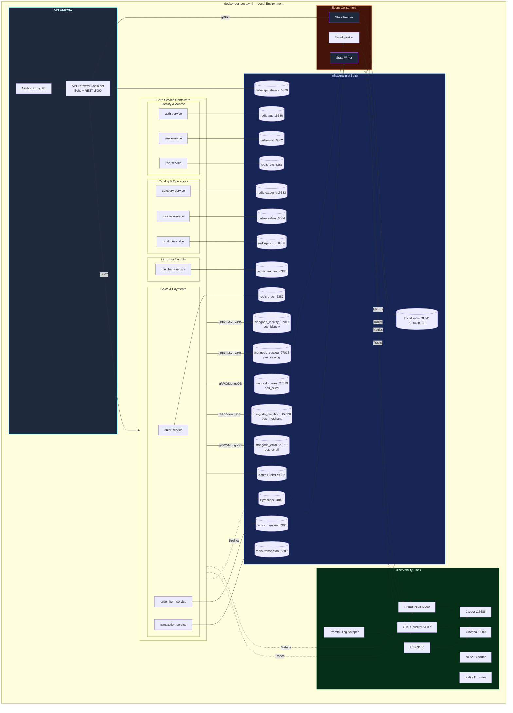
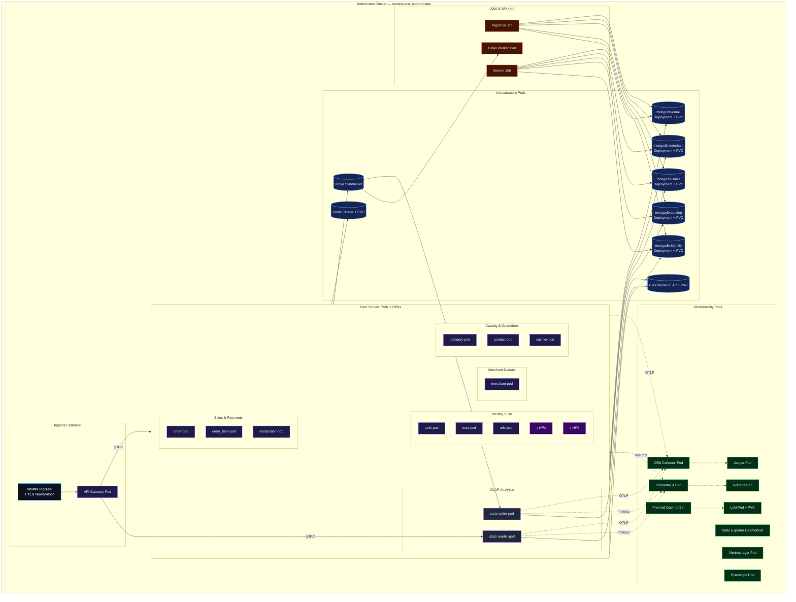

# Distributed Microservices Architecture — Point of Sale Platform

A production-grade, highly resilient, and fully observable **point of sale (POS) microservices backend** built in **Go (Golang)**. Designed around domain-driven service boundaries following Clean Architecture principles, it distributes retail workloads — authentication, merchants, catalog, cashiers, orders, and payments — across self-contained, micro-deployable services while maintaining high consistency and performance.

Each retail and identity business domain — Users, Roles, Merchants, Categories, Products, Cashiers, Order Items, Orders, Transactions — lives in its own self-contained microservice. These services communicate synchronously via lightweight **gRPC** protocols and asynchronously using **Apache Kafka** event propagation, exposing a unified entry point through a **REST API Gateway** built with **Echo** and NGINX. All outbound gRPC access to another service's data is funneled through a dedicated **adapter layer** (`pkg/adapter/<domain>/`), keeping every repository layer MongoDB-only.

For high-performance analytical queries and business intelligence, the platform features a **CQRS-style OLAP & Analytics Layer** powered by **ClickHouse**. Real-time events from Kafka are consumed by **Stats Writer**, which processes and writes them to ClickHouse, while the **Stats Reader** gRPC service provides ultra-fast aggregations (monthly/yearly revenues, best-selling products and categories, transaction success rates, cashier performance) back to the REST API Gateway.

The platform is fortified with a **comprehensive observability suite** (Prometheus, Grafana, Loki, Jaeger, OpenTelemetry, Pyroscope), robust connection pooling via **five dedicated standalone MongoDB instances** — strictly **one database per MongoDB** — **isolated Redis caching** with custom telemetry for each service, and Kubernetes configurations ready for production auto-scaling.

---

## Key Features

| Domain | Capabilities |
| :--- | :--- |
| **Auth & Users** | Secure registration, multi-factor login, stateless JWT access/refresh token lifecycle, password reset workflows, OTP email verification, and `GetMe` profile resolver. Auth reaches users and roles exclusively through the `user` and `role` gRPC adapters. |
| **Roles & RBAC** | Custom permission configuration, granular access control matrices, and sub-second permission evaluation cached via Redis. |
| **Merchants** | Fully featured merchant onboarding, profile details management, business data registration, and merchant performance/transaction reports with full data restoration capabilities (soft delete & restore). |
| **Categories** | Product category management with full CRUD, search, soft-delete/trash/restore flows, and monthly sold-volume analytics. |
| **Products** | Product catalog management (name, price, category assignment), stock tracking, image upload, and monthly sold-quantity analytics. |
| **Cashiers** | Cashier account management per merchant with monthly order/revenue performance analytics per cashier. |
| **Orders & Order Items** | Cart-style order composition with line-item products and quantities, automatic total-price calculation, and soft-delete/trash/restore audit records. Order rollback writes go through the `order_item` gRPC adapter (single writer per collection). |
| **Transactions** | Payment settlement against orders (cash and other methods), change-amount calculation, payment status tracking, and monthly success-rate reports. |
| **OLAP Analytics** | High-performance real-time data warehouse using **ClickHouse** featuring specialized **Stats Writer** (Kafka events consumer with backfill bootstrapping) and **Stats Reader** (gRPC analytics query server) services. |
| **Email Worker** | Kafka-driven asynchronous worker dispatching critical notification emails (OTPs, login alerts, merchant onboarding notices) via SMTP. |
| **Observability** | Multi-dimensional metrics (Prometheus + Grafana), log aggregation (Loki + Promtail), end-to-end distributed tracing (Jaeger + OpenTelemetry), continuous CPU/Memory profiling (Pyroscope), and resource monitors (Node and Kafka exporters). |
| **Deployment** | Local orchestration using Docker Compose (featuring isolated Redis instances, ClickHouse server, and five standalone MongoDB instances), and auto-scaling Kubernetes manifests configured with Horizontal Pod Autoscalers (HPA). |

---

## Architecture Overview

The platform implements a **Distributed Microservices Architecture**. Each business service is logical, decoupled, and self-contained inside the `service/` directory, possessing its own independent gRPC boundary. An **API Gateway** (Echo + NGINX) acts as the unified edge router, routing and translating client REST HTTP requests into fast gRPC downstream communications.

### Core Architecture Principles

- **Domain-Driven Boundary Isolation**: Every service owns its database access, caching layers, and service logic, strictly forbidding cross-boundary database sharing.
- **One Database = One MongoDB**: The five bounded contexts (`pos_identity`, `pos_catalog`, `pos_merchant`, `pos_sales`, `pos_email`) each get their **own dedicated MongoDB server**. There is no shared cluster and no cross-context storage layer — `pkg/database/names.go` is the source of truth for the names, and `ContextPrefix()` maps each name to its env prefix (`MONGO_IDENTITY`, `MONGO_CATALOG`, `MONGO_SALES`, `MONGO_MERCHANT`, `MONGO_EMAIL`). Each service declares its database via `Config.DBName` (fail-hard — an empty name aborts startup) and cross-context access goes through gRPC, never a shared database handle.
- **Adapter Boundary**: Outbound gRPC clients live in `pkg/adapter/<domain>/`, never in `service/*/repository/` — the repository layer talks only to MongoDB. One package per remote domain (user, role, merchant, cashier, product, category, order, orderitem), each exposing narrow `Query`/`Command` interfaces over a single concrete struct, with an optional `DependencyGuard` wired at construction.
- **Clean Architecture**: Standardized layers of `handler → service → repository` ensure that business domains remain unaffected by framework or database changes.
- **Per-Context Connection Pooling**: A service opens exactly **one** Mongo client — the one for its own context — so pool limits (`MONGO_MAX_POOL_SIZE`, default 100) apply per instance rather than being shared. Multi-context tooling (`migrate`, `seeder`) deliberately opens one client per context and closes them all on exit.
- **OLAP & CQRS Pattern**: Transactional (OLTP) writes are processed in MongoDB, while analytical (OLAP) read queries are redirected to a dedicated ClickHouse database populated asynchronously via Kafka events.
- **Event-Driven Resilience**: Apache Kafka decouples transaction events, ensuring side effects like email billing and stats writing remain completely non-blocking.
- **Resilience Patterns**: Circuit breakers, request rate limiters, and load monitors in `pkg/resilience` are applied per dependency through `adapter.WithDependencyGuard` at the dial site (`apps/server.go`); a nil guard is a safe passthrough.
- **OTel Telemetry Integration**: Standardized OpenTelemetry middleware injects trace IDs across gRPC boundaries, allowing seamless trace propagation from the client REST HTTP edge down to mongodb and ClickHouse operations.



---

## Database Topology

**One database = one MongoDB.** There are five bounded contexts, therefore **five independent standalone MongoDB servers** — no replica set, no shared cluster. The source of truth for the database names is `pkg/database/names.go`; `ContextPrefix()` maps each name to the env prefix that points at its server. Each service sets `Config.DBName` in its `cmd/main.go`, and the server **fails hard at startup** if it is empty (there is no silent default database).

| Database | MongoDB instance (local port) | Kubernetes Service | Owning services | Collections |
| :--- | :--- | :--- | :--- | :--- |
| `pos_identity` | `mongodb_identity` (`:27017`) | `mongodb-identity` | `auth`, `user`, `role` | `users`, `roles`, `user_roles`, `refresh_tokens`, `reset_tokens` |
| `pos_catalog` | `mongodb_catalog` (`:27018`) | `mongodb-catalog` | `category`, `product` | `categories`, `products` |
| `pos_sales` | `mongodb_sales` (`:27019`) | `mongodb-sales` | `order`, `order_item`, `transaction` | `orders`, `order_items`, `transactions` |
| `pos_merchant` | `mongodb_merchant` (`:27020`) | `mongodb-merchant` | `merchant`, `cashier` | `merchants`, `merchant_documents`, `cashiers` |
| `pos_email` | `mongodb_email` (`:27021`) | `mongodb-email` | `email` | `outbox_events`, `consumer_inbox` |

Each instance is reached through its own env prefix, and every prefix falls back to the legacy single-instance keys when unset:

| Context | Env prefix | Connection keys read |
| :--- | :--- | :--- |
| `pos_identity` | `MONGO_IDENTITY` | `MONGO_IDENTITY_URI` → `MONGO_IDENTITY_HOST` / `_PORT` / `_USERNAME` / `_PASSWORD` |
| `pos_catalog` | `MONGO_CATALOG` | `MONGO_CATALOG_URI` → `MONGO_CATALOG_HOST` / `_PORT` / … |
| `pos_sales` | `MONGO_SALES` | `MONGO_SALES_URI` → `MONGO_SALES_HOST` / `_PORT` / … |
| `pos_merchant` | `MONGO_MERCHANT` | `MONGO_MERCHANT_URI` → `MONGO_MERCHANT_HOST` / `_PORT` / … |
| `pos_email` | `MONGO_EMAIL` | `MONGO_EMAIL_URI` → `MONGO_EMAIL_HOST` / `_PORT` / … |

Notes:

- **One writer per collection.** Within a shared bounded context, exactly one service writes each collection: `user` owns `users`, `role` owns `roles` + `user_roles`, `auth` owns `refresh_tokens` + `reset_tokens`, `category` owns `categories`, `product` owns `products`, `merchant` owns `merchants` + `merchant_documents`, `cashier` owns `cashiers`, `order` owns `orders`, `order_item` owns `order_items`, `transaction` owns `transactions`.
- **Cross-context access goes through `pkg/adapter`, not Mongo.** `merchant`/`cashier` resolve users via `useradapter`, `product` resolves categories + merchants via adapters, `order` writes order items via `orderitemadapter` (compensating rollback included), and `auth` reaches users and roles via `useradapter` + `roleadapter` — even though all three identity services share the `pos_identity` instance. The adapter boundary is now reinforced at the storage layer: no service even holds a client for another context's server.
- Within a bounded context, read-only access to a sibling service's collection is allowed where explicitly intended (e.g. `user`-service reads `roles` to resolve the default role); anything crossing a context boundary is always gRPC.
- `apigateway`, `stats_reader`, and `stats_writer` do not touch MongoDB at all. The offline backfill path was refactored onto the same gRPC adapters as the live path, so `stats_writer` no longer opens a Mongo client either.
- `migrate` and `seeder` are the only multi-context tools. They iterate the context list, open one client per server via `database.NewMongoClientForContext(log, dbName)`, and disconnect every client before exiting.

---

## Service Catalog

The `service/` directory holds **16 Go modules** — **14 runtime services** plus the `migrate` (index bootstrap) and `seeder` (dev data) jobs:



---

## Internal Service Architecture

Every logical business service follows a **Clean Architecture** pattern with strict layering. Dependencies flow inward, keeping the core business logic free from infrastructure concerns.



Key rule: `repository/` contains **MongoDB access only**; every dependency on another service is expressed as an adapter type (e.g. `useradapter.Repository`, `roleadapter.Repository`) constructed in `apps/server.go` from a dialed gRPC client, optionally wrapped with a `DependencyGuard`.

---

## Data & Event Flow

### Synchronous Flow (gRPC & Cache Read-Through)

All external client API requests go through REST API HTTP requests. The API Gateway authorizes the JWT, connects with the correct downstream gRPC modular server, checks Redis caching, and on a cache miss fetches MongoDB from **that service's own context instance**.



### Cross-Service Flow (gRPC Adapters)

When a service needs data owned by another service, it calls the remote service through `pkg/adapter/<domain>/`. The adapter maps proto responses into shared domain models, translates errors into shared `AppError`s (preserving `errors.Is` semantics), and optionally wraps every call with a circuit breaker.



### Asynchronous Flow (Kafka Notification & Stats Event Pipeline)

High-performance sales modifications (like order creation or payment settlements) trigger background events published directly to Apache Kafka brokers. The isolated Email service listens to Kafka for notifications, while the Stats Writer service consumes the same events and materializes them into ClickHouse for analytics.



---

## Observability Architecture



| Pillar | Tool | Purpose |
| :--- | :--- | :--- |
| **Metrics** | Prometheus + Grafana | Core metrics tracking (CPU, memory, request error rates, gRPC latencies, DB connection states). |
| **Logging** | Loki + Promtail | Centralized structured JSON logger for indexing logs by service, queryable via LogQL. |
| **Tracing** | OpenTelemetry + Jaeger | Distributed system tracing across API gateway and internal gRPC services. |
| **Profiling** | Pyroscope | Continuous memory/CPU profiling to eliminate allocation memory leaks in transaction loops. |
| **Alerting** | Alertmanager | Automated notification system triggered during latency hikes or service disconnects. |

---

## Deployment Architectures

### Docker Compose (Local Development)

The Docker Compose configuration provisions **five standalone MongoDB containers** (one per bounded context, host ports `27017`–`27021`) plus eleven isolated Redis databases, all inside a single containerized environment to replicate real microservices patterns. A separate **infra-only compose** (`docker-compose.infra.yml`) boots just the five MongoDB instances, Redis, Kafka, ClickHouse, and the observability stack for local development where services run natively via `just services-up`.



### Kubernetes (Production Ready)

Our enterprise Kubernetes infrastructure resides inside the dedicated `point-of-sale` namespace, configuring scalable nodes utilizing Horizontal Pod Autoscalers and GitOps-style base/overlay manifests.



#### MongoDB deployment & sync ordering

Each instance lives in `deployments/kubernetes/base/mongodb/` as a single manifest holding its **PersistentVolumeClaim + Deployment + ClusterIP Service** (`mongodb-identity.yaml` … `mongodb-email.yaml`), with one shared `network-policy.yaml` selecting every pod labelled `tier: mongodb`. The overlay pins the ArgoCD **sync-waves** so the dependency chain is explicit:

| Wave | Resource | Why |
| :--- | :--- | :--- |
| `-1` | the five MongoDB Deployments | everything else depends on them |
| `0` | `migrate` Job (`Replace=true`) | needs the databases to exist; runs before the services |
| `2` | the 14 runtime Deployments | last, once indexes are in place |

The `migrate` Job additionally has a `wait-for-mongo` initContainer that polls all five Mongo Services before running, and its own Egress-only NetworkPolicy. Because the databases are now in-cluster Sync resources rather than external dependencies, `migrate` is no longer an ArgoCD **PreSync hook**.

---

## Technology Stack

| Category | Selected Technologies | Purpose |
| :--- | :--- | :--- |
| **Language** | Go (Golang v1.25) | High-performance compiled concurrent backend execution. |
| **API Edge Gateway** | Echo (REST API) | High-performance REST API Gateway engine with auto-generated Swagger UI. |
| **RPC Inter-service** | gRPC + Protobuf | Blazing fast, contract-first synchronous communications. |
| **Adapter Layer** | `pkg/adapter/<domain>` | Typed outbound gRPC clients (9 domains) mapping proto ↔ domain models with optional circuit-breaker guards. |
| **OLTP Database** | MongoDB v7 | Safe ACID ledger persistent storage system — five standalone servers, one database each. |
| **OLAP Database** | ClickHouse | Ultra-high performance column-oriented data warehouse for aggregations and analytics. |
| **DB Topology** | 1 Database = 1 MongoDB | Five independent standalone MongoDB servers (`pos_identity`, `pos_catalog`, `pos_sales`, `pos_merchant`, `pos_email`) — no replica set, no shared cluster, so a failure in one context cannot take down another. |
| **Type-Safe Queries** | MongoDB Aggregation Pipeline | Code generator translating strict MongoDB aggregation pipelines into Go code. |
| **DB Migrations** | MongoDB Migrate | Incremental database schema version manager. |
| **Caching Tier** | Redis | Multi-database low-latency key-value cached engine. |
| **Messaging Stream** | Apache Kafka | Asynchronous high-throughput messaging event bus. |
| **Token Manager** | JWT | Secure stateless request authentication standard. |
| **Observability** | OpenTelemetry + Jaeger | Vendor-neutral distributed telemetry pipeline and visualization. |
| **Continuous Profiler**| Pyroscope | Real-time memory allocation tracker to identify hot paths. |
| **Docker Engine** | Compose | Local environment virtualization orchestration. |
| **Orchestrator** | Kubernetes | Production-scale auto-scaling pod clustering infrastructure. |

---

## Getting Started

### Prerequisites

Ensure the following system packages are locally configured:

- [Git](https://git-scm.com/)
- [Go](https://go.dev/) (v1.23+)
- [Docker](https://www.docker.com/) & [Docker Compose](https://docs.docker.com/compose/)
- [Just Task Runner](https://github.com/casey/just)
- [Protobuf Compiler](https://grpc.io/docs/protoc-installation/) (for codegen updates)

### 1. Clone the Workspace

```sh
git clone https://github.com/MamangRust/microservice-pointofsale-grpc.git
cd microservice-pointofsale-grpc
```

### 2. Prepare Environment Configurations

Environment files are already tracked in the repository — no copy step is needed:

- `.env` — root variables used by native (non-containerized) service runs
- `deployments/local/docker.env` — variables injected into the Docker Compose containers

Adjust values (database credentials, Redis password, secret key) as needed for your environment.

> **MongoDB keys.** Each bounded context reads its **own** env prefix — `MONGO_IDENTITY_URI`, `MONGO_CATALOG_URI`, `MONGO_SALES_URI`, `MONGO_MERCHANT_URI`, `MONGO_EMAIL_URI` — which are already populated in `.env` (native runs, ports `27017`–`27021`) and `deployments/local/docker.env` (containers, service names). Resolution order per context is: `MONGO_<CTX>_URI` → `MONGO_<CTX>_HOST` / `_PORT` / `_USERNAME` / `_PASSWORD` → the base `MONGO_URI` / `MONGO_HOST` / … → `localhost:27017`. That fallback chain means a legacy single-instance deployment still boots unchanged (all five contexts then share one server), which is handy for a quick start but defeats the isolation the topology is designed for. The database **name** is *not* read from the environment: each service sets `Config.DBName` from `pkg/database/names.go`, so `MONGO_DB`/`MONGO_DATABASE` are intentionally absent.

### 3. Start Local Environment (Docker Compose)

Launch all infrastructure utilities, telemetry containers, and application submodules:

```sh
# Compile Docker images & boot Compose layers
just build-up

# Execute MongoDB Migrate migration scripts
just migrate

# (Optional) Insert development mock data into DB
just seeder
```

Ensure everything has booted successfully:

```sh
just ps
```

Alternatively, for local native development (services run from `bin/` while only infrastructure runs in containers):

```sh
# Boot the five MongoDB instances, Redis, Kafka, ClickHouse, and observability stack
just infra-up

# Build binaries and start services locally (no Kafka-dependent workers)
just services-up
```

### 4. Port Map Registry

| Application/Service | Port Configuration / URL |
| :--- | :--- |
| **Swagger API Documentation** | [http://localhost/swagger/index.html](http://localhost/swagger/index.html) |
| **REST API Gateway Edge** | [http://localhost/api/*](http://localhost/api/*) |
| **API Gateway Direct** | [http://localhost:5000](http://localhost:5000) |
| **API Gateway Direct Swagger** | [http://localhost:5000/swagger/index.html](http://localhost:5000/swagger/index.html) |
| **auth gRPC / HTTP** | `localhost:50051` / `localhost:8081` |
| **role gRPC / HTTP** | `localhost:50052` / `localhost:8082` |
| **user gRPC / HTTP** | `localhost:50053` / `localhost:8083` |
| **category gRPC / HTTP** | `localhost:50054` / `localhost:8084` |
| **cashier gRPC / HTTP** | `localhost:50055` / `localhost:8085` |
| **merchant gRPC / HTTP** | `localhost:50056` / `localhost:8086` |
| **order_item gRPC / HTTP** | `localhost:50057` / `localhost:8087` |
| **order gRPC / HTTP** | `localhost:50058` / `localhost:8088` |
| **product gRPC / HTTP** | `localhost:50059` / `localhost:8089` |
| **transaction gRPC / HTTP** | `localhost:50060` / `localhost:8090` |
| **Grafana Dashboard Portal** | [http://localhost:3000](http://localhost:3000) *(Credentials: `admin`/`admin`)* |
| **Prometheus Telemetry** | [http://localhost:9090](http://localhost:9090) |
| **Jaeger Distributed Tracing** | [http://localhost:16686](http://localhost:16686) |
| **Pyroscope Profiling Panel** | [http://localhost:4040](http://localhost:4040) |
| **MongoDB — `pos_identity`** | `localhost:27017` |
| **MongoDB — `pos_catalog`** | `localhost:27018` |
| **MongoDB — `pos_sales`** | `localhost:27019` |
| **MongoDB — `pos_merchant`** | `localhost:27020` |
| **MongoDB — `pos_email`** | `localhost:27021` |
| **Kafka Broker** | `localhost:9092` (internal) / `localhost:29092` (host) |
| **ClickHouse Native TCP** | `localhost:9000` |
| **ClickHouse HTTP Interface** | `localhost:8123` |
| **Loki Log Aggregator** | [http://localhost:3100](http://localhost:3100) |

To fully stop the development system:

```sh
just down
```

---

## Justfile Reference

The workspace includes a `justfile` featuring these recipes:

| Target/Recipe | Execution Scope |
| :--- | :--- |
| `just build-up` | Recompiles local service Dockerfiles and launches the compose stacks. |
| `just up` | Launches existing Compose containers without rebuilding images. |
| `just down` | Stops the local compose container stacks and releases networks. |
| `just ps` | Displays health, uptime, and mapped ports of the container cluster. |
| `just migrate` | Runs the MongoDB index bootstrap across all five context instances (opens one client per context, idempotent). |
| `just seeder` | Populates mock entities (users, roles, merchants, products, cashiers). |
| `just generate-proto` | Compiles `.proto` files into the generated Go module under `/pb`. |
| `just generate-swagger` | Regenerates OpenAPI/Swagger schema specifications. |
| `just build` | Locally compiles all sub-services into unified `bin/` folders. |
| `just build-image` | Builds Docker images for all compose services (`<name>-pointofsale-service:1.0`). |
| `just image-load` | Loads built images into the local minikube cluster. |
| `just infra-up` / `infra-down` / `infra-ps` | Boots/stops only the infrastructure stack (five MongoDB instances, Redis, Kafka, ClickHouse, observability) for local E2E. |
| `just services-up` / `services-down` | Starts/stops the local service binaries against the infra stack. |
| `just e2e-hurl` | Runs the full E2E suite (infra up → migrate → seed → services → hurl endpoint checks). |
| `just smoke-trace` | Smoke test verifying trace_id continuity across HTTP → gRPC → Kafka → email (via Jaeger). |
| `just smoke-stack-lifecycle yes` | Lifecycle infra compose test — clean volume start, restart/stop/start/down-up without data loss. |
| `just tidy-all` | Iterates across all go modules, executing `go mod tidy` cleanups. |
| `just test-unit` | Executes Go standard library test routines under `pkg/`. |
| `just test-integration` | Triggers end-to-end integration flows under `tests/`. |
| `just test-all` | Chain-runs standard unit tests alongside integration suites. |

> **Workspace note.** The root has no `go.mod` — a `go.work` file ties together the `pb`, `pkg`, `shared`, `service/*`, and `tests` modules. Build and vet commands must run **inside each module** (e.g. `cd service/auth && go build ./...`); `go test ./...` under `tests/` uses Docker (testcontainers) for MongoDB, Redis, and ClickHouse.
>
> The integration harness spins up **one** testcontainers MongoDB and gives each bounded context its own logical database on it (`tests/databases.go`, enforced by `tests/isolation_test.go`). That works because of the env fallback chain above — `MONGO_<CTX>_*` is unset in tests, so every context resolves to the single container. The production topology (five separate servers) is therefore **not** what the integration tests exercise; only `docker-compose` / Kubernetes do that.

---

## Workspace Directory Tree

```
microservice-pointofsale-grpc/
├── proto/                          # Protobuf contracts (12 domain packages + common/google)
│   ├── auth.proto                  #   Auth token & verification contracts
│   ├── user/ role/                 #   Identity contracts (auth-facing read RPCs included)
│   ├── merchant/ merchant_document/
│   ├── category/ product/ cashier/
│   ├── order/ order_item/ transaction/
│   ├── stats/                      #   OLAP analytics query contracts
│   └── common/                     #   Shared pagination & error types
├── pb/                             # Generated protobuf Go module (separate module)
├── shared/                         # Shared Go module
│   ├── domain/                     #   Domain models (record/request/response)
│   ├── mapper/                     #   Domain ↔ Protobuf mappers
│   ├── cache/                      #   Redis cache abstraction
│   ├── convert/                    #   Time & string conversion helpers
│   ├── observability/              #   Cache/Tracing monitoring interceptors
│   ├── errors/                     #   AppError types + per-domain error vars
│   └── errorhandler/               #   Service-layer error handling utilities
├── pkg/                            # Platform-level Go module
│   ├── adapter/                    #   Outbound gRPC adapters, one package per remote domain (9)
│   │   ├── user/ role/ merchant/ cashier/
│   │   ├── product/ category/ order/ orderitem/
│   │   └── convert/                #   proto → domain helpers (TimePtr, Nullable*)
│   ├── auth/                       #   JWT token manager
│   ├── clickhouse/                 #   ClickHouse connection + schema bootstrap
│   ├── database/                   #   Per-context Mongo clients + names.go (5 DBs) + EnsureIndexes
│   ├── kafka/                      #   Kafka writer/reader configurations
│   ├── outbox/                     #   Transactional outbox pattern helpers
│   ├── resilience/                 #   Circuit breaker, rate limiter, load monitor
│   ├── server/                     #   gRPC server bootstrap (DBName fail-hard)
│   ├── otel/                       #   Telemetry hooks config
│   ├── logger/                     #   Structured Zap logs wrappers
│   └── ...                         #   hash, email, emailretry, event, dotenv, upload_image, ...
├── service/                        # 16 Go modules — 14 runtime services + migrate/seeder
│   ├── apigateway/                 #   Unified REST API Gateway (Echo)      [no Mongo]
│   ├── auth/                       #   Authentication (via user/role adapters)  pos_identity
│   ├── user/                       #   User profile administration          pos_identity
│   ├── role/                       #   RBAC roles + user_role assignment    pos_identity
│   ├── merchant/                   #   Merchant registration & documents    pos_merchant
│   ├── category/                   #   Product category management          pos_catalog
│   ├── product/                    #   Product catalog management           pos_catalog
│   ├── cashier/                    #   Cashier account management           pos_merchant
│   ├── order/                      #   Order & cart processor               pos_sales
│   ├── order_item/                 #   Order line-item composer             pos_sales
│   ├── transaction/                #   Payment settlement handler           pos_sales
│   ├── stats_writer/               #   Kafka → ClickHouse consumer + backfill
│   ├── stats_reader/               #   ClickHouse gRPC analytics server
│   ├── email/                      #   Asynchronous Kafka notification worker
│   ├── migrate/                    #   MongoDB index bootstrap (idempotent)
│   └── seeder/                     #   Development mock data seeder
├── tests/                          # Integration suites per service + DB-mapping contract tests
├── deployments/
│   ├── local/                      #   Docker compose + docker-compose.infra.yml + scripts
│   └── kubernetes/                 #   Production K8s manifests (base + overlays, HPAs, volumes)
│       ├── base/mongodb/           #     mongodb-identity … mongodb-email (PVC+Deployment+Service)
│       └── overlays/production/    #     image pins, sync-waves, network policies
├── observability/                  #   Telemetry pipeline yaml profiles (Loki, OTEL, Promtail, rules)
├── nginx/                          #   Reverse-proxy edge rules
├── scripts/                        #   Helper shell scripts
├── uploads/                        #   Uploaded product images
└── images/                         #   Architecture diagrams
```

---

## License

This project is open-sourced under the MIT License for educational and development purposes.

---

<p align="center">
  Built with Go, gRPC, Apache Kafka, ClickHouse OLAP, and a passion for high-performance point of sale microservices.
</p>
